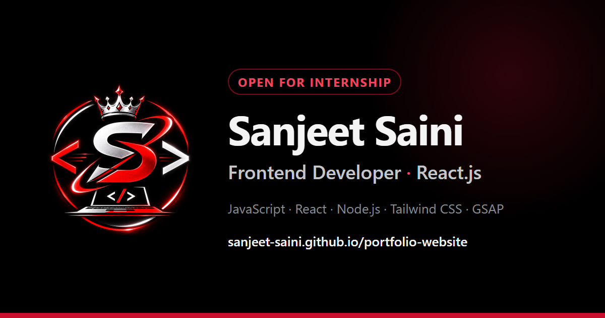

# Sanjeet Saini – Developer Portfolio

My personal portfolio website, built with **React** and **Vite**. It shows my projects, skills, education and a downloadable resume, with smooth scroll animations and a responsive layout for mobile, tablet and desktop.

**Live site:** https://sanjeet-saini.github.io/portfolio-website/



## Features

- Sections for Hero, About, Skills, Projects, Education and Contact, with an active-section highlight in the navbar
- Typewriter heading, cursor glow, scroll progress bar and reveal-on-scroll animations, all written as custom React components and hooks
- Project cards with live demo and source code links, plus a separate section for AI-assisted builds
- ATS-friendly resume written in HTML and generated as a PDF with a build script
- Fully responsive layout and Open Graph image for link previews
- All content kept in one data file (`src/data/portfolio.js`), so the site can be updated without touching components

## Tech Stack

React 18 · Vite · JavaScript (ES6+) · CSS3 · gh-pages

## Project Structure

```
src/
  components/   # Header, Hero, About, Skills, Projects, Education, Contact, Footer ...
  hooks/        # useActiveSection, useReveal
  data/         # portfolio.js – all site content
resume/         # resume.html + PDF build script
branding/       # Open Graph image source + build script
public/         # images, favicon, resume PDF
```

## Run Locally

```bash
git clone https://github.com/sanjeet-saini/portfolio-website.git
cd portfolio-website
npm install
npm run dev
```

## Useful Scripts

| Command | What it does |
|---|---|
| `npm run dev` | Start the local dev server |
| `npm run build` | Build the site into `dist/` |
| `npm run deploy` | Build and publish to GitHub Pages |
| `npm run resume` | Rebuild the resume PDF from `resume/resume.html` |

## Contact

- Email: [sanjeetsaini91@gmail.com](mailto:sanjeetsaini91@gmail.com)
- LinkedIn: [linkedin.com/in/sanjeet-saini-880b1827a](https://www.linkedin.com/in/sanjeet-saini-880b1827a)
- GitHub: [github.com/sanjeet-saini](https://github.com/sanjeet-saini)
